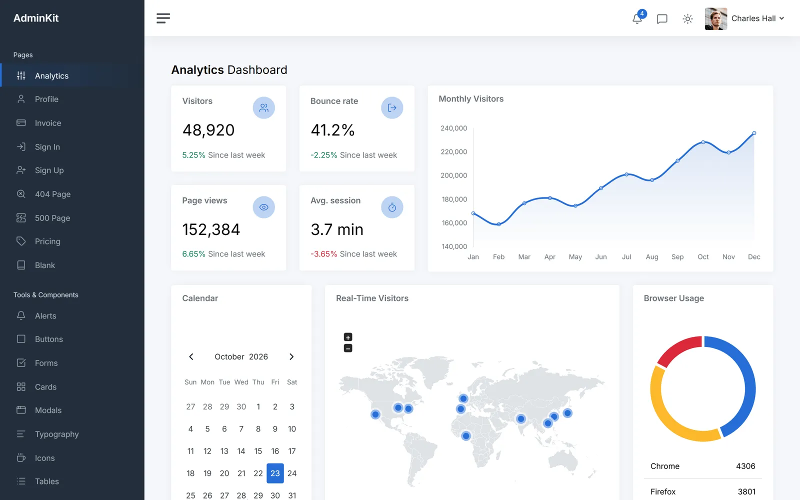

<p align="center">
  <a href="https://github.com/adminkit/adminkit"></a>
</p>

<h3 align="center">AdminKit</h3>

<p align="center">
  AdminKit is a free & open-source HTML dashboard & admin template based on Bootstrap 5.
</p>

<p align="center">
  <a href="https://www.npmjs.com/package/@adminkit/core" rel="nofollow"></a>
  <a href="https://github.com/adminkit/adminkit/blob/main/LICENSE"></a>
  <a href="https://github.com/adminkit/adminkit/issues?q=is%3Aopen+is%3Aissue"></a>
  <a href="https://github.com/adminkit/adminkit/issues?q=is%3Aissue+is%3Aclosed"></a>
  <a href="https://demo.adminkit.io/" rel="nofollow"></a>
  <a href="https://adminkit.io/#download"></a>
  <br>
<a href="https://github.com/adminkit/adminkit"></a>
</p>

## Preview

A professional admin and dashboard template based on Bootstrap 5, with dashboards, pages, forms, tables, charts and icons. Free and MIT-licensed. [Open the demo](https://demo.adminkit.io/).

<picture>
  <source media="(prefers-color-scheme: dark)" srcset=".github/screenshots/dashboard-dark.webp">
  
</picture>

## Features

- **Dark mode:** light, dark and auto, built on Bootstrap's color modes.
- **No jQuery:** AdminKit and every plugin it uses run on plain JavaScript.
- **Accessible:** targets WCAG 2.2 AA in light and dark mode.
- **Fully responsive:** the sidebar turns into an off-canvas sheet on small screens.
- **Any framework:** plain HTML, CSS and JavaScript, with setup guides for React, Vue, Angular, Laravel and more.
- **npm and CDN:** `@adminkit/core` ships TypeScript declarations and is safe to import during server-side rendering.
- **Modern tooling:** Vite, Handlebars pages and Sass.

## AdminKit and AdminKit PRO

Need more? [AdminKit PRO](https://adminkit.io/pricing/) adds more pages, dashboards and plugins, AI features and a settings panel.

<!-- stats:start -->

|                       | AdminKit      | [AdminKit PRO](https://adminkit.io/pricing/) |
| --------------------- | ------------- | -------------------------------------------- |
| Pages                 | 20            | 53                                           |
| Dashboards            | 1             | 5                                            |
| Plugins               | 4             | 11                                           |
| Icons                 | 2,015         | 4,071                                        |
| Sidebar color schemes | 1             | 3                                            |
| Dark mode             | ✔             | ✔                                            |
| AI features           |               | ✔                                            |
| Settings panel        |               | ✔                                            |
| Support               | GitHub issues | Email                                        |
| License               | MIT           | Commercial                                   |

<!-- stats:end -->

## Quick start

Clone the repository and install the dependencies (Node.js 24):

```sh
git clone https://github.com/adminkit/adminkit.git
cd adminkit
npm install
```

Start the development server on http://localhost:8080:

```sh
npm start
```

Build the production files into `dist/`:

```sh
npm run build
```

You can also [download a zip](https://adminkit.io/#download), or install the built files from npm (`npm install @adminkit/core`) or the unpkg CDN; see [Download](https://adminkit.io/docs/getting-started/download/).

## Frameworks

Setup guides for [HTML](https://adminkit.io/docs/frameworks/html/), [Laravel](https://adminkit.io/docs/frameworks/laravel/), [Django](https://adminkit.io/docs/frameworks/django/), [Rails](https://adminkit.io/docs/frameworks/rails/), [Symfony](https://adminkit.io/docs/frameworks/symfony/), [React](https://adminkit.io/docs/frameworks/react/), [Next.js](https://adminkit.io/docs/frameworks/nextjs/), [Vue](https://adminkit.io/docs/frameworks/vue/), [Nuxt](https://adminkit.io/docs/frameworks/nuxt/), [Angular](https://adminkit.io/docs/frameworks/angular/), [SvelteKit](https://adminkit.io/docs/frameworks/sveltekit/) and [Astro](https://adminkit.io/docs/frameworks/astro/).

## Documentation

[Quick start](https://adminkit.io/docs/getting-started/quick-start/), [file structure](https://adminkit.io/docs/getting-started/contents/), [customization](https://adminkit.io/docs/getting-started/customization/), [dark mode](https://adminkit.io/docs/getting-started/dark-mode/), [icons](https://adminkit.io/docs/icons/lucide-icons/), [animations](https://adminkit.io/docs/getting-started/animations/), [accessibility](https://adminkit.io/docs/getting-started/accessibility/) and every component are documented at [adminkit.io/docs](https://adminkit.io/docs/).

## Browser support

| <br/>Edge | <br/>Firefox | <br/>Chrome | <br/>Safari | <br/>iOS Safari |
| --------------------------------------------------------------------------------------------------------- | ------------------------------------------------------------------------------------------------------------------ | --------------------------------------------------------------------------------------------------------------- | --------------------------------------------------------------------------------------------------------------- | --------------------------------------------------------------------------------------------------------------------------- |
| 111+                                                                                                      | 114+                                                                                                               | 111+                                                                                                            | 16.4+                                                                                                           | 16.4+                                                                                                                       |

## Resources

- [Demo](https://demo.adminkit.io/)
- [Website](https://adminkit.io/)
- [Documentation](https://adminkit.io/docs/)
- [Support](https://adminkit.io/support/)
- [Affiliate Program](https://adminkit.io/affiliate-program)

To report a bug or request a feature, [open a new issue](https://github.com/adminkit/adminkit/issues/new).
